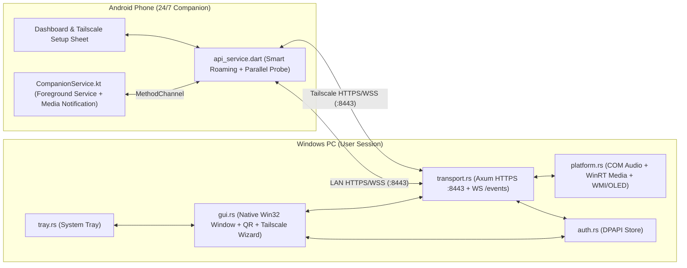

# Tech Spec: PC Remote v5.0 — Native Windows & 24/7 Companion Edition

> Versi 1.0 - 2026-11-22 - Status: Approved
> Turunan dari `PRD.md` dan `project-state.json`

## 1. Ringkasan Teknis
PC Remote v5.0 menggunakan arsitektur klien-server langsung (*peer-to-peer* melalui LAN atau jaringan privat Tailscale pengguna) dengan server Rust native Win32/WinRT di Windows dan aplikasi Flutter + layanan Android Foreground Service di HP. Seluruh manajemen setup PC dipindahkan dari web browser ke jendela GUI Win32/GDI native di dalam executable Rust yang sama.

## 2. Platform & Stack
| Lapisan | Pilihan | Alasan | Sumber |
|---|---|---|---|
| Server & GUI PC | Rust 2024 + `axum` + `windows` (Win32/COM/WinRT/GDI) | Single binary ringan, tanpa PowerShell berkala, akses langsung API Windows & GDI native | Keputusan user + codebase |
| Keamanan Identitas PC | Windows DPAPI + `rustls` (TLS self-signed + SHA-256 pin) + `bcrypt` | Mengikat kunci privat & daftar perangkat ke akun Windows lokal | Codebase `auth.rs` |
| Klien Mobile | Flutter (Dart) + `http` + `flutter_secure_storage` | Mendukung TLS certificate pinning lewat `SecurityContext(withTrustedRoots: false)` | Keputusan user + codebase |
| Servis 24/7 & Notifikasi | Android Native Kotlin `ForegroundService` + `NotificationCompat` + `MethodChannel` | Stabil di Android 8–15 tanpa ketergantungan plugin background pihak ketiga yang rapuh | Usulan teknis |
| Jaringan Luar Rumah | Tailscale resmi (komponen eksternal) | Alamat IP `100.x.y.z` dan MagicDNS permanen tanpa relay pengembang | Keputusan user |
| Web & Installer | Next.js 16 (landing page statis) + NSIS (`PCRemoteRust.nsi`) | Halaman unduhan & migrasi bersih dari Go/Quick Tunnel | Keputusan user |

## 3. Arsitektur

## 4. Pemetaan Fitur ke Komponen
| ID | Sub-fitur | Halaman/Komponen | Endpoint/Aksi | Entitas data |
|---|---|---|---|---|
| M1.1 | Jendela GUI Native Windows | `server-rust/src/gui.rs`, `main.rs` | `gui::start`, `gui::show_or_focus` | `App` state |
| M1.2 | Render QR Pairing Native | `server-rust/src/gui.rs` | `Auth::new_pair()`, GDI `FillRect` | `PairPayload` |
| M1.3 | Wizard Setup Tailscale PC | `server-rust/src/gui.rs`, `transport.rs` | `tailscale status --json`, `ShellExecuteW` | `EndpointsSnapshot` |
| M1.4 | Tray, Close-to-Tray & Autostart | `server-rust/src/tray.rs`, `gui.rs` | `Shell_NotifyIconW`, `HKCU\...\Run` | `Device` list |
| M2.1 | Fast Boot Polling & Auto-Sync | `transport.rs`, `api_service.dart` | `GET /connection?refresh=1`, WS `snapshot` | `alternate_hosts`, `tailscale_urls` |
| M2.2 | Fast Parallel Probe LAN+Tailscale | `app/lib/services/api_service.dart` | `_probeBestEndpoint()` -> `GET /health` | `server_id`, `server_fingerprint` |
| M2.3 | Failover Command Idempotent | `transport.rs`, `api_service.dart` | `POST /*` + `X-Request-Id` + `X-Command-Deadline-Ms` | `CommandCache` |
| M2.4 | Wizard & Deep-Link Tailscale HP | `app/lib/widgets/tailscale_setup_sheet.dart` | Intent `com.tailscale.ipn` / Play Store + test probe | `tailscale_state` |
| M3.1 | Foreground Service 24/7 Background | `CompanionService.kt`, `companion_service.dart` | `MethodChannel('com.pcremote/companion')` | Service state |
| M3.2 | Notifikasi Status Koneksi Live | `CompanionService.kt`, `dashboard_screen.dart` | `updateStatus` -> `NotificationManager` | `connected`, `route` |
| M3.3 | Notifikasi Media Play/Pause/Next/Prev | `CompanionService.kt`, `media_state.dart` | PendingIntent `PREV`/`PLAY_PAUSE`/`NEXT` | `MediaStatus` |
| M3.4 | Tap-to-Open & Izin Notifikasi | `MainActivity.kt`, `settings_screen.dart` | `POST_NOTIFICATIONS` permission + toggle | `companion_enabled` |
| M4.1 | Identitas DPAPI & TLS Pinning | `auth.rs`, `api_service.dart` | `CryptProtectData`, `SecurityContext` | `Store.fingerprint` |
| M4.2 | Pairing QR & Sesi Jangka Panjang | `auth.rs`, `qr_scan_screen.dart` | `POST /auth/pair`, `FlutterSecureStorage` | `Device` |
| M4.3 | Manajemen & Pencabutan Perangkat | `gui.rs`, `transport.rs`, `api_service.dart` | `Auth::revoke`, `POST /auth/logout` | `Store.devices` |
| M4.4 | Proteksi Brute-Force & Server-ID | `auth.rs`, `transport.rs` | `Auth::locked`, `origin_allowed` | `failures` map |
| M5.1 | Master, Device & Sonar COM | `server-rust/src/platform.rs` | `/audio/status`, `/audio/devices`, `/audio/volume` | `IMMDevice` |
| M5.2 | Kontrol Media WinRT Real-Time | `server-rust/src/platform.rs` | `/media/status`, `/media/play|next|prev|seek-*` | `MediaManager` |
| M5.3 | Hybrid Brightness WMI + OLED | `platform.rs`, `platform_overlay.rs` | `GET/POST /system/brightness` | `ALPHA` atomic |
| M5.4 | Power, Sleep, Lock & Shutdown | `server-rust/src/platform.rs` | `/system/lock|sleep|restart|shutdown|display/off` | Session ID check |
| M6.1 | Installer NSIS & Migrasi Go | `installer/rust/PCRemoteRust.nsi` | `taskkill`, `nssm`, shortcuts, firewall | `PCRemoteRustSetup.exe` |
| M6.2 | Deaktivasi /connect & Landing v5.0 | `web/src/app/connect/page.tsx`, `page.tsx` | Static Next.js build & ESLint | Web bundle |
| M6.3 | Port 8443 & Cleanup Flutter | `app/pubspec.yaml`, `api_service.dart`, `qr_scan_screen.dart` | Default port `:8443`, `v5.0.0` | APK build |
| M6.4 | Smoke Test, Roaming & Build | `scripts/rust/smoke.ps1`, `connection_test.dart`, `review_tests.rs` | `cargo test`, `flutter test`, `npm run lint` | CI artifacts |
| M7 | Kontrol Audio & Aplikasi Lanjutan | *(Fase 2)* `platform.rs` (`IAudioSessionManager2`) + `audio_card.dart` | `/audio/sessions`, `/audio/default-device` | `AudioSession` |
| M8 | Navigasi Cepat & Input Remote | *(Fase 2)* `platform.rs` (`SendInput`) + `touchpad_card.dart` | `/input/mouse`, `/input/key`, `/clipboard` | Input event |

## 5. Model Data
- **`Store` (`identity.dpapi` terenkripsi DPAPI):** `server_id: String`, `key_pem: String`, `cert_pem: String`, `fingerprint: String`, `pin_hash: Option<String>`, `devices: Vec<Device>`.
- **`EndpointsSnapshot` (`GET /connection`):**
  - `server_id`, `version`, `fingerprint`
  - `hosts: Vec<String>` (IPv4 LAN aktif)
  - `tailscale_url: String` (`https://<tail_ip>:8443` atau `""`)
  - `tailscale_urls: Vec<String>` (IP Tailscale + MagicDNS `https://<dns_name>:8443`)
  - `tailscale_state: String` (`Running`, `NeedsLogin`, `Stopped`, `Unavailable`)
  - `tailscale_installed: bool`
- **`SharedPreferences` + `FlutterSecureStorage` (Android):**
  - SecureStorage: `auth_token`
  - SharedPreferences: `last_ip`, `alternate_hosts` (JSON list), `tailscale_url`, `tailscale_urls` (JSON list), `tailscale_state`, `server_fingerprint`, `server_id`, `server_version`, `companion_enabled`.

## 6. API / Antarmuka
- `GET /health`: `{ status, version, platform, protocol_version, server_id }` (tanpa auth).
- `POST /auth/pair`: tukar `pair_token` -> `{ token, device_id, expires_at, server_id }`.
- `POST /auth/login`: verifikasi `pin` -> `{ token, device_id, expires_at }`.
- `GET /connection`: (Bearer auth) memicu `refresh_endpoints` on-demand jika `?refresh=1` atau mengembalikan `EndpointsSnapshot` terbaru.
- `GET /events`: WebSocket WSS (Bearer auth) mengirim `snapshot`, `endpoints`, `state_changed`, `resync_required`.
- `GET /audio/status`, `/audio/devices`, `/audio/channels`, `/media/status`, `/system/brightness`.
- `POST /audio/*`, `/media/*`, `/system/*`, `/browser/open` (semua mendukung `X-Request-Id` deduplikasi 300 detik & `X-Command-Deadline-Ms`).

## 7. Autentikasi & Keamanan
- Semua endpoint kontrol dan `/connection` wajib header `Authorization: Bearer <token>` dan ditolak jika terdapat header `Origin` (HTTP 403).
- Klien Flutter hanya mempercayai sertifikat TLS yang SHA-256 DER-nya persis sama dengan `server_fingerprint` hasil QR pairing (`SecurityContext(withTrustedRoots: false)`).
- Lockout brute-force: 5 kegagalan pada `/auth/pair` atau `/auth/login` mengunci IP sumber selama 15 menit (maksimal 4096 entri dengan fail-closed).

## 8. Non-Fungsional
- Server Rust berjalan di `tokio` 2 worker threads dengan `tokio::task::spawn_blocking` untuk seluruh panggilan COM/WinRT/WMI/DPAPI.
- `refresh_endpoints` memakai `CREATE_NO_WINDOW` (`0x08000000`) dan timeout 3 detik agar tidak memunculkan jendela konsol.
- Saat offline, Flutter mempertahankan kredensial dan menampilkan status Standby di notifikasi tanpa menghapus token kecuali menerima HTTP 401 eksplisit.

## 9. Integrasi Pihak Ketiga
- **Tailscale Windows (`tailscale.exe status --json` & `tailscale-ipn.exe`):** Hanya pembacaan status read-only oleh server; pengguna login mandiri melalui aplikasi resmi Tailscale.
- **Tailscale Android (`com.tailscale.ipn`):** Dibuka via intent Android atau diarahkan ke Google Play Store jika belum terpasang.

## 10. Struktur Proyek & Konvensi
- `server-rust/src/`: `main.rs`, `gui.rs`, `tray.rs`, `auth.rs`, `transport.rs`, `platform.rs`, `platform_overlay.rs`, `review_tests.rs`.
- `app/lib/`: `services/api_service.dart`, `services/companion_service.dart`, `widgets/tailscale_setup_sheet.dart`, `screens/`, `models/`.
- `app/android/app/src/main/kotlin/.../`: `MainActivity.kt`, `CompanionService.kt`.
- `installer/rust/PCRemoteRust.nsi`, `scripts/rust/smoke.ps1`, `web/src/app/`.
- Variabel lingkungan opsional server: `PCREMOTE_PORT` (default `8443`), `PCREMOTE_DATA_DIR`.

## 11. Deployment & Lingkungan
- Windows: build `cargo build --locked --release`, kemas dengan NSIS `PCRemoteRust.nsi` -> `PCRemoteRustSetup.exe`.
- Android: `flutter build apk --release`.
- CI: `.github/workflows/rust.yml`.

## 12. Strategi Tes
- Rust: `cargo fmt --check`, `cargo clippy --locked --all-targets -- -D warnings`, `cargo test --locked`.
- Integrasi lokal: `./scripts/rust/smoke.ps1` pada port terisolasi `18443/18444`.
- Flutter: `flutter analyze`, `flutter test` (`connection_test.dart` menguji auto-sync endpoint, parallel failover LAN->Tailscale, idempotent `X-Request-Id` retry, dan companion service state).
- Web: `npm run lint` di `web/`.

## 13. Risiko Teknis
- **Kompilasi GDI Win32 di Rust:** Pastikan seluruh flag fitur `windows` (`Win32_Graphics_Gdi`, `Win32_System_Registry`, dll.) tersedia di `Cargo.toml` dan tidak menimbulkan warning Clippy.
- **Android 13+ Foreground Service Types & Notification Permission:** `AndroidManifest.xml` wajib mendeklarasikan `FOREGROUND_SERVICE`, `FOREGROUND_SERVICE_MEDIA_PLAYBACK` / `FOREGROUND_SERVICE_CONNECTED_DEVICE` (atau `dataSync`), dan `POST_NOTIFICATIONS`.

## 14. Asumsi & Pertanyaan Terbuka
- Fitur Fase 2 (`M7` Per-App Mixer & `M8` Touchpad/Input) akan dikerjakan setelah seluruh check Fase 1 hijau.
