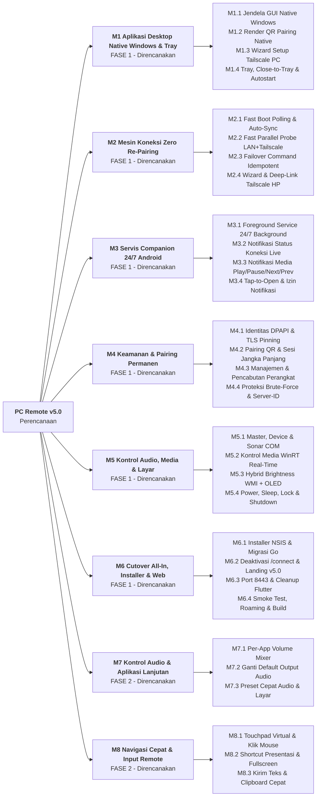

# Kerangka Fitur: PC Remote v5.0 — Native Windows & 24/7 Companion Edition

> Sumber: `docs/prd/pc-remote-v5/project-state.json` (Disetujui)

## Pohon Teks

```text
PC Remote v5.0 — Native Windows & 24/7 Companion Edition (Perencanaan)

Fase 1 (Status: Direncanakan)
- M1 Aplikasi Desktop Native Windows & Tray
  - M1.1 Jendela GUI Native Windows
  - M1.2 Render QR Pairing Native
  - M1.3 Wizard Setup Tailscale PC
  - M1.4 Tray, Close-to-Tray & Autostart
- M2 Mesin Koneksi Zero Re-Pairing
  - M2.1 Fast Boot Polling & Auto-Sync
  - M2.2 Fast Parallel Probe LAN+Tailscale
  - M2.3 Failover Command Idempotent
  - M2.4 Wizard & Deep-Link Tailscale HP
- M3 Servis Companion 24/7 Android
  - M3.1 Foreground Service 24/7 Background
  - M3.2 Notifikasi Status Koneksi Live
  - M3.3 Notifikasi Media Play/Pause/Next/Prev
  - M3.4 Tap-to-Open & Izin Notifikasi
- M4 Keamanan & Pairing Permanen
  - M4.1 Identitas DPAPI & TLS Pinning
  - M4.2 Pairing QR & Sesi Jangka Panjang
  - M4.3 Manajemen & Pencabutan Perangkat
  - M4.4 Proteksi Brute-Force & Server-ID
- M5 Kontrol Audio, Media & Layar
  - M5.1 Master, Device & Sonar COM
  - M5.2 Kontrol Media WinRT Real-Time
  - M5.3 Hybrid Brightness WMI + OLED
  - M5.4 Power, Sleep, Lock & Shutdown
- M6 Cutover All-In, Installer & Web
  - M6.1 Installer NSIS & Migrasi Go
  - M6.2 Deaktivasi /connect & Landing v5.0
  - M6.3 Port 8443 & Cleanup Flutter
  - M6.4 Smoke Test, Roaming & Build

Fase 2 (Status: Direncanakan)
- M7 Kontrol Audio & Aplikasi Lanjutan
  - M7.1 Per-App Volume Mixer
  - M7.2 Ganti Default Output Audio
  - M7.3 Preset Cepat Audio & Layar
- M8 Navigasi Cepat & Input Remote
  - M8.1 Touchpad Virtual & Klik Mouse
  - M8.2 Shortcut Presentasi & Fullscreen
  - M8.3 Kirim Teks & Clipboard Cepat
```

## Peta Visual


